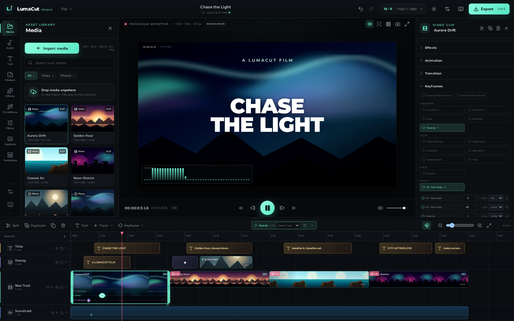
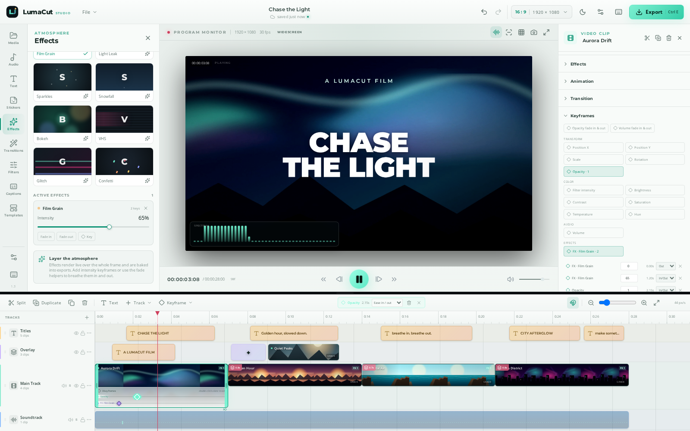
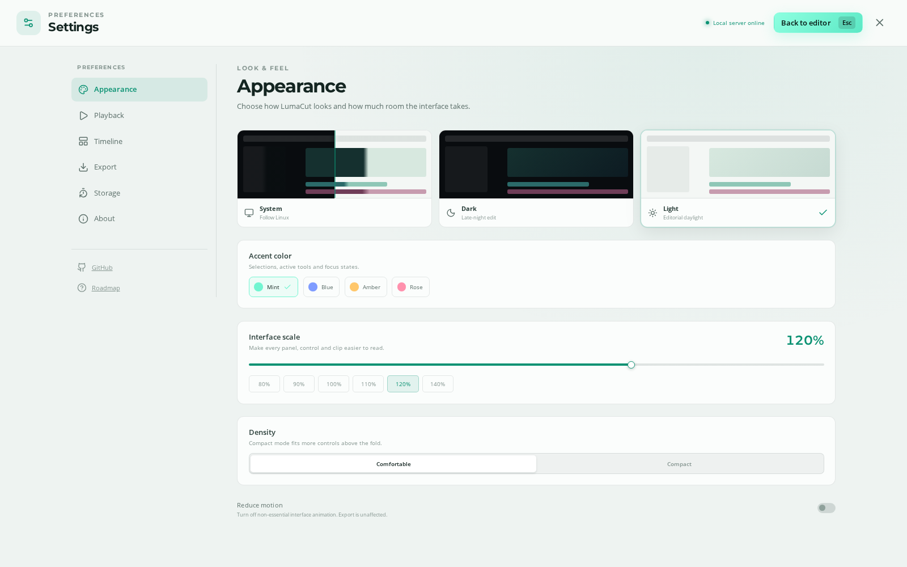
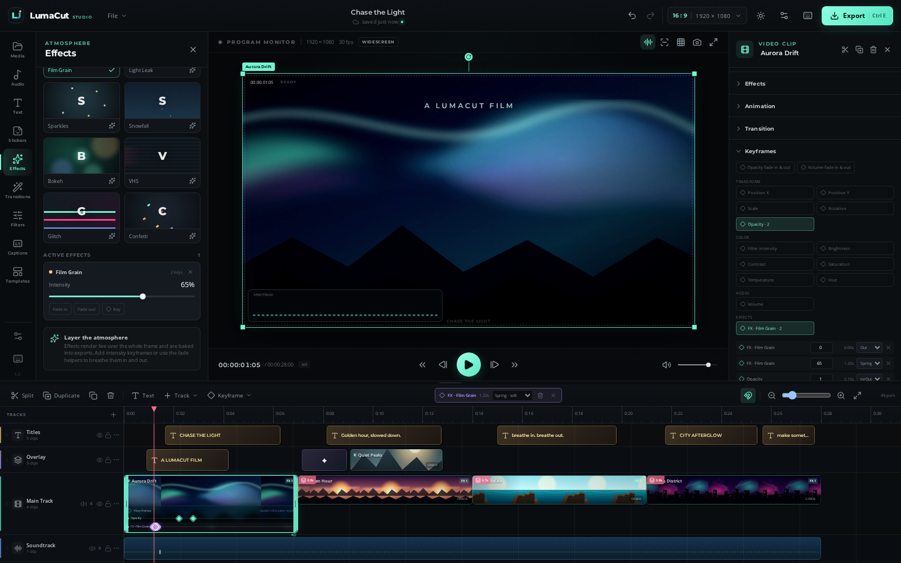
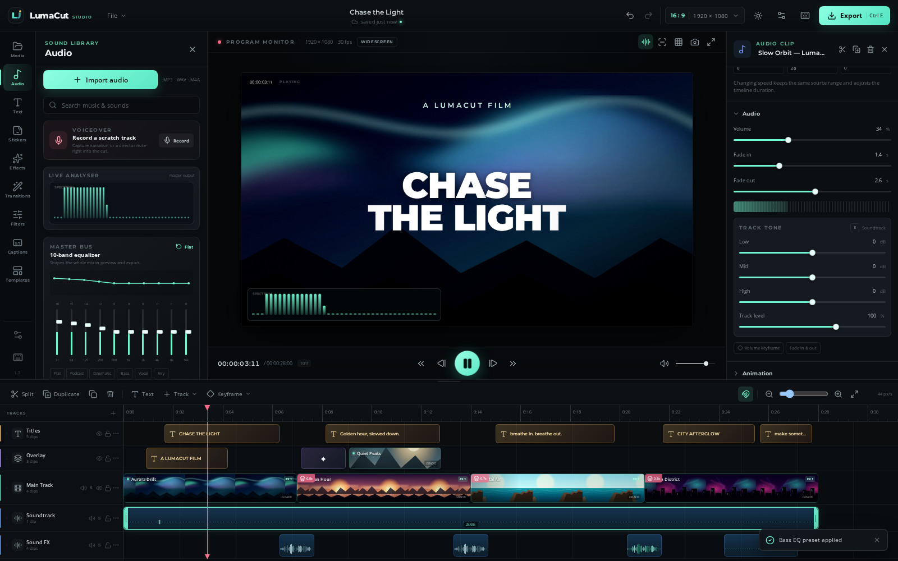
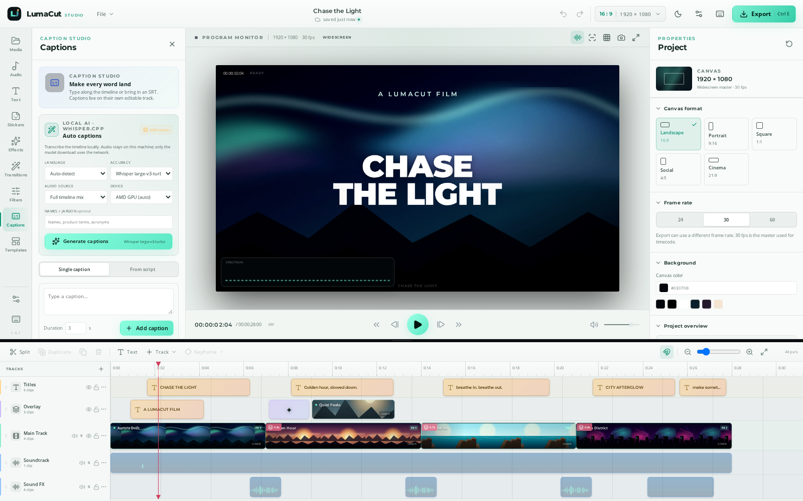
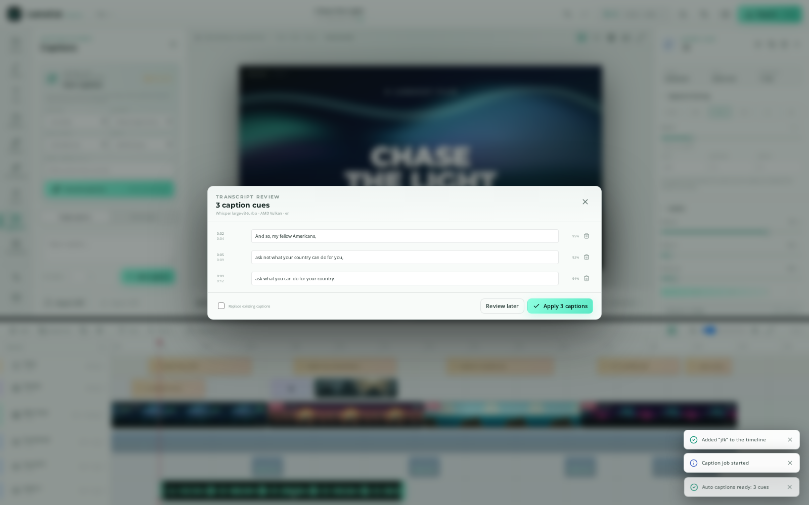
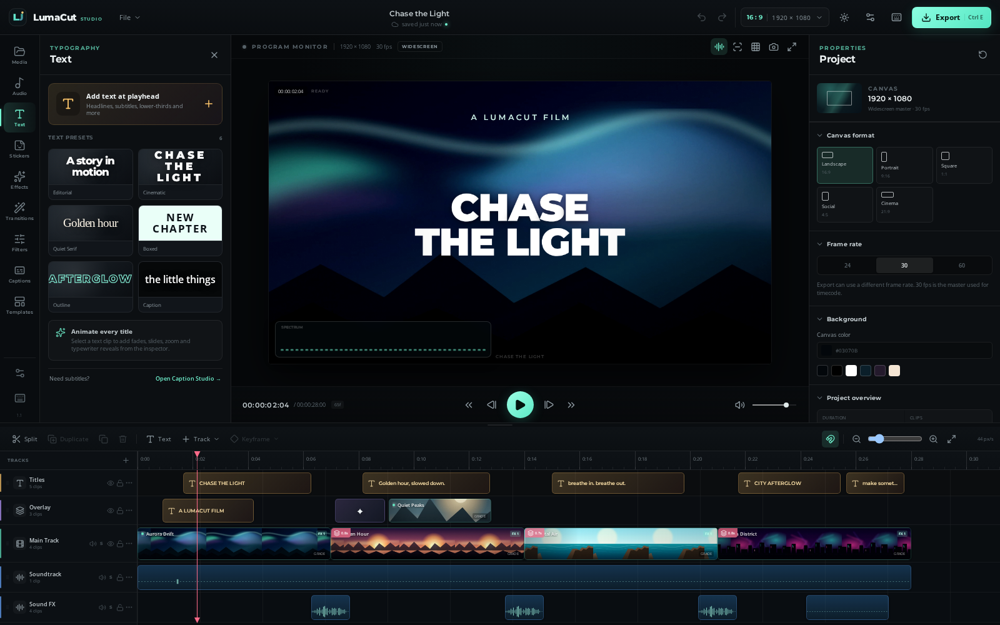
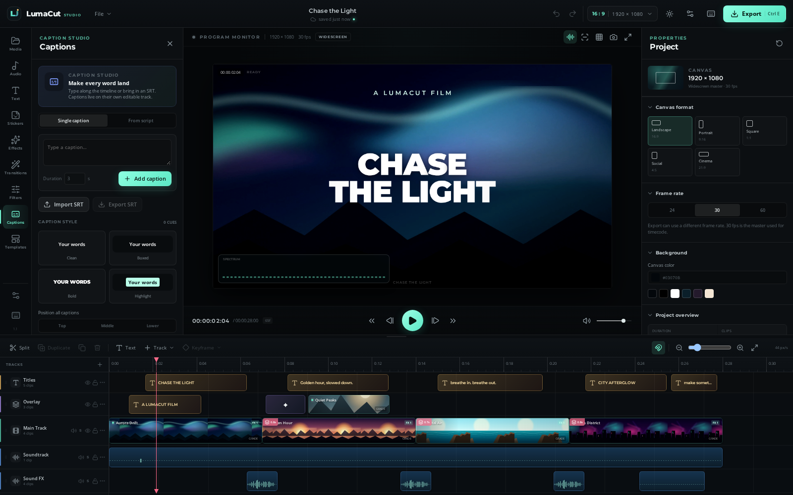
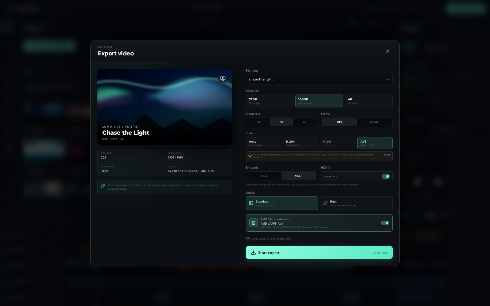

<p align="center">
  
</p>

<h1 align="center">LumaCut</h1>

<p align="center">
  <strong>A local-first, CapCut-style video editor for Linux.</strong><br>
  Multi-track editing, spring-eased keyframes, captions, effects, a 10-band audio EQ, AMD Radeon hardware encoding and 10-bit HDR delivery — tuned for Fedora, packaged for Linux.
</p>

<p align="center">
  <a href="https://github.com/martintondel02/lumacut/releases/latest"></a>
  <a href="https://github.com/martintondel02/lumacut/actions/workflows/ci.yml"></a>
  <a href="LICENSE"></a>
  
  
  
  
  
  
  
  
</p>

<p align="center">
  <a href="#download">Download</a> ·
  <a href="#features">Features</a> ·
  <a href="#local-auto-captions">Auto captions</a> ·
  <a href="#screenshots">Screenshots</a> ·
  <a href="#amd-radeon-acceleration">AMD acceleration</a> ·
  <a href="#quick-start">Quick start</a> ·
  <a href="#keyboard-shortcuts">Shortcuts</a> ·
  <a href="#architecture">Architecture</a> ·
  <a href="#roadmap">Roadmap</a>
</p>

---

## Download

**[Get the latest Linux release →](https://github.com/martintondel02/lumacut/releases/latest)**

| Package | Best for | Install |
| --- | --- | --- |
| **`LumaCut-1.4.1-x86_64.rpm`** | Fedora, RHEL and compatible systems | `sudo dnf install ./LumaCut-*.rpm` |
| **`LumaCut-1.4.1-x86_64.AppImage`** | Any Linux distribution | `chmod +x LumaCut-*.AppImage` then run it |
| **`LumaCut-1.4.1-amd64.deb`** | Debian, Ubuntu, Linux Mint and derivatives | `sudo apt install ./LumaCut-*.deb` |

All builds include the editor, its local media server and the **whisper.cpp auto-caption runtime**. **Node.js is not required** for packaged builds. You do need **FFmpeg / ffprobe** available on `PATH` for media probing and export. Auto captions also need the system **Vulkan loader**; the RPM declares `vulkan-loader`, the DEB declares `libvulkan1`, and normal Fedora/Ubuntu desktops already have it. The first caption job downloads a model once.

```bash
# Fedora — official repos provide the same binary as ffmpeg-free
sudo dnf install ffmpeg-free

# Debian / Ubuntu
sudo apt install ffmpeg

# Arch
sudo pacman -S ffmpeg
```

> Fedora's official tree ships the binary as `ffmpeg-free`; RPM Fusion ships it as `ffmpeg`. The RPM requires `/usr/bin/ffmpeg`, so either provider works. H.265 software encoding needs an FFmpeg build with `libx265` — see [docs/HARDWARE.md](docs/HARDWARE.md#h265--hevc-installation). Releases are built by the tagged GitHub Actions workflow in [`.github/workflows/release.yml`](.github/workflows/release.yml) and include a `SHA256SUMS` file.

---

## Why LumaCut?

Most editors make you choose between a polished timeline and owning your footage. LumaCut is built for the other path:

- **Local-first by design.** Your media, waveforms, projects and exports live in folders on your Linux machine. No account, no upload, no telemetry.
- **A real timeline.** Multi-track clips, trim handles, snapping, keyframe rails, direct manipulation and complete track management.
- **Finished-film tools.** Local AI auto captions, typography, transitions, effects, color grades, spring keyframes, audio mixing and 4K exports.
- **Yours to shape.** Light/dark themes, four accent colors, 80–140% interface scaling, compact density and reduced motion.
- **Tuned for AMD.** LumaCut probes the actual VAAPI encoders on your Radeon, uses AV1/H.264/HEVC hardware encoding when available, and falls back cleanly to CPU. The Fedora RPM is a first-class target.
- **Hackable.** React + TypeScript on the front end, a small Express/FFmpeg media server, and an Electron shell. Read it, run it, change it.

> LumaCut is an independent, original project inspired by modern mobile/desktop editors. It is not affiliated with CapCut or ByteDance.

---

## Features

### Timeline & track management

| | |
| --- | --- |
| **Multi-track timeline** | Video, overlay, titles, captions, soundtrack and SFX tracks |
| **Direct manipulation** | Drag clips in time or across compatible tracks, trim in/out, snap |
| **Clip operations** | Split, duplicate, copy/paste, multi-select, delete, lock-safe editing |
| **Track management** | Add, remove with confirmation, drag-reorder, rename, recolor, hide, lock |
| **Audio tracks** | Mute, solo, per-track gain and a 3-band tone stack |
| **Navigation** | Ruler scrubbing, 12–220 px/s zoom, fit-to-view, resizable timeline |
| **Visual feedback** | Repeated thumbnails, waveform peaks, keyframe lanes, FX/filter/transition badges |

### Keyframes & motion

| | |
| --- | --- |
| **Keyframes 2.0** | Position, scale, rotation, opacity, color grading, filter intensity, text styling, effect strength and volume |
| **Easing** | Linear, ease in, ease out, ease in/out, **spring (soft)**, **spring (snappy)** and **bounce** |
| **Timeline keyframes** | Expand a selected clip into color-coded lanes, add with double-click, drag to retime, select and delete |
| **Inspector editor** | Add keys per channel, edit time/value/easing, remove, or use quick fade-in/out helpers |
| **Auto-key** | Optional mode that writes a keyframe when you change an animatable property at the playhead |
| **Speed** | 0.25×–4× with source-aware retiming, plus Ken Burns push-ins on stills |

### Audio & EQ

| | |
| --- | --- |
| **Visualizer** | Live spectrum, waveform ribbon and radial pulse, drawn from the master analyser |
| **Master EQ** | 10-band graphic equalizer with live curve and Flat / Podcast / Cinematic / Bass / Vocal / Airy presets |
| **Track tone** | Per-track low shelf, mid peak and high shelf, ±12 dB, plus track gain and solo |
| **Preview = export** | The track EQ, master EQ and gain bus feed both the monitor and the capture destination |
| **Voiceover** | Record a microphone take and drop it onto the timeline |
| **Fades** | Per-clip audio fades, volume keyframes and transition-aware mixing |

### Program monitor

| | |
| --- | --- |
| **Canvas compositor** | Up to 4K-shaped projects, 16:9 / 9:16 / 1:1 / 4:5 / 21:9 |
| **Layer transforms** | Move, scale, rotate, flip, opacity and blend modes in the preview |
| **Monitoring** | Safe margins, rule-of-thirds grid, snapshot, fullscreen |
| **Visualizer overlay** | Toggle from the monitor chrome or Settings → Playback |

### Type, captions & design

| | |
| --- | --- |
| **Typography** | Six presets + bundled Montserrat, Open Sans and Luma Serif |
| **Text controls** | Font, size, weight, colour, stroke, shadow, box, alignment, spacing |
| **Animations** | Fade, slide, zoom, spin and typewriter entrances/exits |
| **Auto captions** | Local whisper.cpp transcription with VAD, word timings, language detection and review-before-apply |
| **Captions** | Single cues, script-to-timed-captions, SRT import/export, caption styling |
| **Stickers & shapes** | Emoji layers and vector shapes with transforms and keyframes |
| **Color** | Ten cinematic grades, intensity, manual brightness/contrast/saturation/temperature/hue |
| **Effects** | Film grain, light leak, sparkles, snow, bokeh, VHS, glitch and confetti |
| **Transitions** | Dissolve, fade to black/white, slides, zoom, blur, whip pan and spiral |

### Settings & accessibility

| | |
| --- | --- |
| **Theme** | System / Dark / Light, applied before first paint, plus a quick top-bar toggle |
| **Accent** | Mint, blue, amber and rose, with coordinated light-theme tokens |
| **Interface scale** | 80–140% with layouts verified at 1200–1600 px and high-scale fallbacks |
| **Density** | Comfortable and compact spacing for smaller displays |
| **Motion** | Reduced-motion preference and `prefers-reduced-motion` support |
| **Playback** | Preview quality, loop, follow playhead, waveform visibility and auto-expand keyframes |
| **Export defaults** | Resolution, frame rate, format and quality |

### Projects & delivery

| | |
| --- | --- |
| **Autosave** | Instant local project persistence with undo/redo history |
| **Portable projects** | Download and reopen `.lumacut` files |
| **Auto captions** | Local Whisper large-v3-turbo on AMD Vulkan · CPU fallback · full mix or selected clip |
| **AMD acceleration** | Auto-detects AMD Radeon VAAPI · AV1, H.264 or HEVC · live encoder label · CPU fallback |
| **Codec picker** | Explicit Auto / H.264 / H.265 / AV1 with live availability and install guidance |
| **10-bit & HDR10** | 10-bit H.265/AV1 in MP4 or WebM; HDR10 PQ/BT.2020 for MP4 10-bit |
| **Export** | H.264 / H.265 / AV1 MP4 · VP9 / AV1 WebM · AAC/Opus · 720p / 1080p / 4K · 24/30/60 fps |
| **Export workflow** | Real-time canvas capture + server-side FFmpeg hardware/software encoding and trimming |
| **History** | Recent exports with file paths, sizes and direct download |
| **Schema migration** | Opening a 1.0 project upgrades effects, keyframes, tracks and audio fields in place |

---

## Screenshots

<p align="center">
  
</p>

<p align="center">
  
  
</p>

<p align="center">
  
  
</p>

<p align="center">
  
  
</p>

<p align="center">
  
  
</p>

<p align="center">
  
</p>


### Local auto captions

LumaCut 1.4 can transcribe the timeline locally with **whisper.cpp on AMD Vulkan** — no cloud speech API. Choose **Full timeline mix** or **Selected clip**, pick a language and accuracy level, then review the transcript before applying it.

- **Default model:** Whisper large-v3-turbo q5_0, 547 MiB, multilingual, comfortable on an 8 GB GPU.
- **Smaller model:** Whisper small, 466 MiB, for lower-end GPUs and CPUs.
- **Speech detection:** Silero VAD avoids inventing captions from music or silence.
- **Review first:** edit cues, inspect confidence, then replace or append to the caption track as one undoable edit.
- **Private by default:** audio stays local. The only network request is the one-time, checksum-verified model download.
- **Benchmark:** 9 minutes of speech transcribed in ~6.5 s on an RX 9070 XT, with a ~925 MiB VRAM delta.

See **[docs/AUTOCAPTIONS.md](docs/AUTOCAPTIONS.md)** for requirements, model management, performance and troubleshooting.

---

## AMD Radeon acceleration

LumaCut 1.4.1 is built with AMD Radeon systems in mind. The media server does not simply trust `ffmpeg -encoders`; it finds AMD GPUs through sysfs and `lspci`, then probes every available VAAPI encoder with a tiny real encode on each render node.

- **MP4:** H.264 → HEVC → AV1, whichever the driver actually exposes.
- **WebM:** AV1 → VP9 hardware, with software VP9 as the fallback.
- **Safe fallback:** if a hardware encode fails mid-export, auto mode retries the exact same file with the CPU encoder.
- **Visible state:** the Export dialog and Settings → About show the detected GPU, the selected encoder, and whether a hardware encode succeeded.

On some Fedora + Mesa combinations — including RDNA4 cards — **AV1 VAAPI** is exposed while H.264/HEVC VAAPI is not. That is handled automatically: LumaCut exports AV1 with real GPU acceleration. If you need maximum player compatibility, pick **H.264** in the codec picker and turn **AMD GPU acceleration** off, or install RPM Fusion FFmpeg for software H.265.

### H.265 / HEVC installation

Fedora's `ffmpeg-free` often lacks `libx265`, so the H.265 codec card is disabled until you install an FFmpeg build that has it:

```bash
sudo dnf install https://mirrors.rpmfusion.org/free/fedora/rpmfusion-free-release-$(rpm -E %fedora).noarch.rpm

# If Fedora's ffmpeg-free is installed:
sudo dnf swap ffmpeg-free ffmpeg --allowerasing
# Otherwise:
sudo dnf install ffmpeg

ffmpeg -hide_banner -encoders | grep libx265
```

Restart LumaCut after installing; the server probes codecs at startup. Ubuntu's FFmpeg normally includes `libx265` already.

### 10-bit and HDR10

- **10-bit** is available for H.265 and AV1; H.264 stays 8-bit.
- **HDR10** is available for MP4 + 10-bit + H.265/AV1.
- LumaCut color-manages the SDR canvas to **PQ / BT.2020** at a 100-nit reference. It tags HDR10 correctly, but it **does not recover HDR highlights from an SDR timeline**; native HDR source grading is future work.
- Hardware 10-bit uses `p010` VAAPI upload. Software 10-bit uses `yuv420p10le`.

**Fedora install:**

```bash
sudo dnf install ffmpeg-free libva-utils
sudo dnf install ./LumaCut-1.4.1-x86_64.rpm
```

The RPM requires `/usr/bin/ffmpeg`, which `ffmpeg-free` satisfies.

<p align="center">
  
</p>

Full setup, encoder matrix, troubleshooting and local RPM build instructions live in **[docs/HARDWARE.md](docs/HARDWARE.md)**.

---

## Quick start

### Run LumaCut from source

Requirements:

- Linux with Wayland or X11
- **Node.js 20+**
- **FFmpeg** and **ffprobe** on `PATH` (tested with FFmpeg 9)

```bash
git clone https://github.com/martintondel02/lumacut.git
cd lumacut
npm install
npm run dev
```

Open **http://127.0.0.1:5173**. The first launch loads the demo film **“Chase the Light”**, so every control is ready to try.

### Production web build

```bash
npm run build
npm run start
```

Open **http://127.0.0.1:4317**.

### Native desktop window

```bash
npm run desktop        # build + open the Electron window
npm run desktop:start  # launch an existing build
```

The desktop app runs the media server inside Electron, so it does not need a separate Node process. Source runs keep media in the repository. Packaged runs store media, exports and cached metadata under `~/Videos/LumaCut/` (or Electron's user-data directory as a fallback).

### Build Linux packages

```bash
npm run dist:linux   # AppImage + .deb + .rpm, written to release/
npm run dist:dir     # unpacked app for inspection
```

Packaging is configured with `electron-builder` in `package.json`. Pushing a `v*` tag runs the release workflow and attaches the generated AppImage, `.deb`, `.rpm` and `SHA256SUMS` to the GitHub release.

Local RPM builds need `rpmbuild` and the `libcrypt` compatibility library used by the bundled `fpm` runtime:

```bash
sudo dnf install rpm-build libxcrypt-compat
npm run build
npx electron-builder --linux rpm --publish never
```

---

## Keyboard shortcuts

<details>
<summary><strong>Playback, editing, project and canvas shortcuts</strong></summary>

<br>

| Shortcut | Action |
| --- | --- |
| `Space` | Play / pause |
| `←` / `→` | Step one frame |
| `Shift` + `←` / `→` | Jump one second |
| `Home` / `End` | Go to start / end |
| `B` | Split selected clip at playhead |
| `Ctrl/⌘ + Z` | Undo |
| `Ctrl/⌘ + Shift + Z` | Redo |
| `Ctrl/⌘ + D` | Duplicate selected |
| `Ctrl/⌘ + C` / `V` | Copy / paste clip |
| `Delete` | Delete selected clip or selected keyframe |
| `Ctrl/⌘ + S` | Save project to disk |
| `Ctrl/⌘ + O` | Open a `.lumacut` file |
| `Ctrl/⌘ + N` | New project |
| `Ctrl/⌘ + E` | Open export |
| `Ctrl/⌘ + ,` | Open settings |
| `T` | Add text at playhead |
| `1` – `9` | Switch asset panel |
| `?` | Shortcut sheet |
| `Esc` | Deselect clip / clear keyframe / close |

</details>

<details>
<summary><strong>Keyframe and timeline gestures</strong></summary>

<br>

| Gesture | Action |
| --- | --- |
| Select a clip | Expands its animated channels into keyframe lanes |
| Double-click a keyframe lane | Add a keyframe at that time |
| Drag a diamond | Retime the keyframe with snapping |
| Click a diamond | Select it and show the easing pill |
| `Delete` | Remove the selected keyframe |
| Keyframe menu | Add any animatable channel at the playhead |
| Easing picker | Choose linear, ease, spring or bounce |
| Drag a track grip | Reorder tracks with a drop indicator |
| Double-click a track name | Rename the track |

</details>

Double-click a media item to add it at the playhead. Drop media anywhere to import. Drag the handles on a selected frame to transform it.

---

## The demo film

LumaCut ships with **“Chase the Light”**, an original 28-second demo cut built from locally generated media. Every asset is synthesized by `scripts/generate-demo.mjs` with SVG and FFmpeg — no third-party footage, no licensing surprises.

It includes four cinematic clips, two stills, an original ambient score, sound effects, transitions, grades, titles, a picture-in-picture overlay and a caption-ready timeline.

```bash
npm run setup:demo   # regenerate the demo library
```

---

## Architecture

```text
src/
  components/          React editor UI, panels, timeline, transport, export dialog
    AudioVisualizer.tsx Canvas analyser overlay (spectrum / waveform / radial)
    MasterEq.tsx       10-band master equalizer UI
    SettingsPage.tsx   Themes, scale, playback, timeline, export and storage settings
  engine/
    canvasRenderer.ts  Canvas compositor: media, text, shapes, effects, transitions
    mediaPool.ts       Media elements, track/master EQ bus, analyser, playback and capture
  lib/
    keyframes.ts       Channel registry, easing curves, interpolation and effect helpers
    migrate.ts         1.0 → 1.1 project migration
  store/               Zustand + Immer state, history, settings and autosave
server/
  index.mjs            Express media server, FFprobe metadata, waveforms, AMD detection and FFmpeg export
electron/main.cjs      Desktop shell + embedded local server
scripts/               Demo generation and Linux installer
tests/                 Playwright smoke tests
```

The renderer uses normalized transforms, so reframing a project is non-destructive. Export captures the same canvas compositor used by the preview, then FFmpeg applies constant frame rate, exact duration and the requested codec/container. If AMD acceleration is available, the captured frames are uploaded to the Radeon and encoded by VAAPI; otherwise the same pipeline uses software H.264/VP9.

The audio bus is:

```text
media element → clip gain → track 3-band tone → track gain/solo
              → master 10-band EQ → master volume → analyser → monitor
                                                     └──────→ capture (export)
```

The visualizer taps the analyser and never modifies the signal. Master and track EQ are part of the render graph, so preview and export hear the same mix.

### Tech stack

- **React 19 + TypeScript + Vite**
- **Zustand + Immer** for editor state and undo history
- **Canvas 2D + Web Audio API** for compositing and audio
- **Express 5 + Multer + FFmpeg**
- **Electron 45 + electron-builder** for AppImage, `.deb` and `.rpm` packages
- **AMD VAAPI** probing and hardware encoding through FFmpeg
- **Playwright** for browser and Electron smoke tests

---

## Where your work lives

| Path | Contents |
| --- | --- |
| `media/` | Imported source files and generated thumbnails (source runs) |
| `exports/` | Finished MP4 / WebM renders (source runs) |
| `data/assets.json` | Media library index and waveform peaks (source runs) |
| `~/Videos/LumaCut/` | Media, exports and data for packaged desktop builds |
| `public/demo/` | Generated demo film, stills and audio |
| Browser local storage | Instant project autosave |
| `*.lumacut` | Portable project downloads |

All processing happens on your machine. Media never leaves the local server, which binds to `127.0.0.1`.

---

## Development

```bash
npm run dev          # media server + Vite
npm run build        # typecheck + production bundle
npm run start        # production server
npm run desktop      # native desktop shell
npm run dist:linux   # AppImage + .deb + .rpm
npm run test:e2e     # Playwright smoke tests
```

For the tests, install the Playwright browser once:

```bash
npx playwright install chromium
```

The test suite covers the demo boot, canvas painting, split/undo, dynamic title tracks, the media API, settings and scaling, timeline keyframes, auto-key, EQ controls, track management, project migration, AMD capabilities, the codec/HDR picker and the auto-caption capability surface.

---

## Roadmap

**1.4 “Local Auto Captions” is shipped.**

- [x] Local whisper.cpp transcription on AMD Vulkan with CPU fallback
- [x] Full-timeline or selected-clip audio source
- [x] Silero VAD, language detection and word-level token timings
- [x] Review, edit, append/replace and undoable caption application
- [x] On-demand checksum-verified model download and model manager UI
- [x] Bundled runtime, model/license documentation and offline path

**1.3 “Codecs & 10-bit” is shipped.**

- [x] Explicit Auto / H.264 / H.265 / AV1 codec picker
- [x] 8-bit and 10-bit output, including 10-bit AV1 hardware encoding
- [x] HDR10 PQ / BT.2020 output for MP4 H.265 and AV1
- [x] Live codec availability and H.265/libx265 installation guidance
- [x] Codec and HDR metadata surfaced in the export result

**1.2 “AMD & Fedora” is shipped.**

- [x] Probe real AMD Radeon VAAPI encoders and prefer hardware automatically
- [x] AV1 / H.264 / HEVC hardware encode with CPU fallback and encoder labels
- [x] AMD GPU acceleration toggle in Export and Settings
- [x] Fedora RPM package, plus AppImage and `.deb`
- [x] Protected `main`, Dependabot, security policy and SHA-256 release checksums
- [x] AMD/Fedora documentation and hardware tests

**1.1 “Accessibility & Animation” is shipped.**

- [x] Settings page with dark / light / system themes, accents and 80–140% scaling
- [x] Keyframes for effects, filters, text and audio
- [x] Spring and bounce easing
- [x] Draggable keyframe blocks on the timeline with add / delete / retime
- [x] Audio visualizer, master 10-band EQ and per-track tone
- [x] Add / remove / reorder / rename / recolor tracks, with solo and gain
- [x] AppImage packaging plus a tagged release workflow
- [x] Light-theme screenshots, schema migration and expanded documentation

Next up:

- Custom bezier easing editor and curve presets
- Keyframe marquee and multi-select retiming
- “Move clips to a new track” when deleting a populated track
- Lane visibility filters and per-channel collapse
- Native HDR source handling and a WebGL/float rendering pipeline
- Intel and NVIDIA acceleration paths

See **[docs/AUTOCAPTIONS.md](docs/AUTOCAPTIONS.md)** for auto-caption setup and model details, **[docs/HARDWARE.md](docs/HARDWARE.md)** for AMD/Fedora setup, **[docs/REWORK_PLAN.md](docs/REWORK_PLAN.md)** for the 1.1 scope and **[CHANGELOG.md](CHANGELOG.md)** for release notes.

---

## Notes & limits

- **Export is real-time.** A 30-second cut takes roughly 30 seconds to capture; hardware encoding shortens the encode step, not the capture step. Keep the window in the foreground.
- **Hardware encoders vary by driver.** Fedora/Mesa may expose AV1, H.264, HEVC or only some of them. LumaCut picks what actually works and labels the result. It never silently pretends a software encode is hardware.
- **Auto captions are local and review-first.** Whisper can mishear music, overlapping speech or names; edit cues before applying them. Speaker labels are not yet included.
- Uploads are capped at 2 GB per file and 30 files per import.
- H.264 export uses whichever encoder FFmpeg exposes: `libx264`, `libopenh264`, `h264_vaapi`, or an `mpeg4` fallback.
- The audio visualizer is **monitor-only** in 1.4. It is intentionally not baked into the exported video.
- **HDR10 is converted from the SDR canvas.** It sets PQ/BT.2020 and 10-bit output but cannot restore highlights that were never in the SDR timeline.
- **H.265 software encoding needs libx265.** Fedora's stock `ffmpeg-free` may not include it; install RPM Fusion FFmpeg or use AV1 hardware encoding.
- Packaged builds expect **FFmpeg / ffprobe** on `PATH`; the `.deb` declares `ffmpeg` and the RPM requires `/usr/bin/ffmpeg`, satisfied by Fedora's `ffmpeg-free` or RPM Fusion `ffmpeg`. H.265 requires `libx265` in that FFmpeg build.
- LumaCut targets a wide desktop window (1180 px minimum).
- The app is built for local desktop use; there is no cloud sync or collaboration layer.

---

## Contributing

Issues, pull requests and thoughtful design feedback are welcome.

- **`main` is protected.** Direct pushes and force-pushes are disabled, all changes land through pull requests, and the **Build & smoke tests** check must pass before merge.
- Read **[CONTRIBUTING.md](CONTRIBUTING.md)** for the dev setup, project structure and testing expectations.
- Use the issue templates for bugs and feature requests.
- Keep changes local-first: no accounts, no telemetry, no mandatory network calls.

If LumaCut helps you make something, star the repo — it makes the next rework easier to justify.

---

## License

MIT © LumaCut contributors. See [LICENSE](LICENSE).

Bundled fonts: Montserrat and Open Sans under the SIL Open Font License; Liberation Serif under the SIL Open Font License. Demo media is generated locally and included under the same MIT terms as the project.
