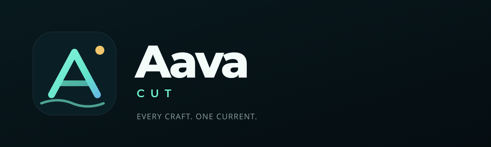

# Aava Brand Guide

> **Aava** · Every craft. One current.  
> Public product house for Mtenk. First product: **Aava Cut**.



---

## 1. Why Aava

**Aava** is a Finnish word for **open sea**.

It was chosen because it is:

- a real word with an image, not an invented tech name
- short, spellable and calm
- broad enough for creative tools, office software and developer tools
- open in feeling without using the generic word “Open”
- visually ownable — horizon, current, depth, night water

The name should feel like a place, not a product category. Aava is the house; the products are the crafts.

### Pronunciation

**AH-vah** (Finnish). In English, AH-vah is preferred. Avoid AY-vah.

### What Aava is not

- not an “AI company”
- not a video-editor-only brand
- not a neon/gradient startup
- not “AavaCut” as one word in public copy
- not a replacement for Mtenk as the legal company

> **Legal structure:** Mtenk is the company. Aava is the public product house. Aava Cut is the first product.

---

## 2. Brand idea

**One current. Many crafts.**

Every Aava product should feel like it belongs to the same body of water:

- **Calm** — tools that reduce noise
- **Precise** — professional control without clutter
- **Open** — local-first, portable, no lock-in
- **Human** — made for people who care about the work

### Positioning

> Aava makes professional creative and productivity software that feels calm, coherent and local-first. One house, many crafts.

### Tagline

**Every craft. One current.**

Use it as the master tagline. Do not put it on every screen; use it in brand surfaces, launches, About, the website and the first-run experience.

### Short descriptors

- Aava — “The open creative house.”
- Aava Cut — “Local-first video editing.”
- Aava Studio — “The creative suite.”
- Aava Office — “Quietly capable productivity.”
- Aava Dev — “Tools for people who build.”

---

## 3. Architecture

```text
Mtenk  (legal company)
└── Aava  (public product house)
    ├── Aava Studio        creative suite
    │   ├── Aava Cut       video
    │   ├── Aava Lens      photo
    │   ├── Aava Type      design / vector
    │   ├── Aava Tone      audio
    │   └── Aava Motion    motion / VFX
    ├── Aava Office        productivity suite
    │   ├── Aava Docs      documents
    │   ├── Aava Sheets    spreadsheets
    │   └── Aava Slides    presentations
    └── Aava Dev           developer suite
        ├── Aava Code      editor / IDE
        └── Aava Flow      automation
```

### Naming rules

1. **Aava** is always title case: `Aava`, not `AAVA` or `aava` in body copy.
2. Products are **Aava + short functional noun**: `Aava Cut`, `Aava Lens`, `Aava Type`.
3. Never `AavaCut` in public copy. File names and package IDs may use `aava-cut`.
4. Do not use “AI”, “Pro”, “Max”, “X”, “360” or version numbers as part of a product name.
5. Product nouns are English, short and literal: Cut, Lens, Type, Tone, Motion, Docs, Sheets, Slides, Code, Flow.
6. A suite name is optional and only for bundles: Studio, Office, Dev.
7. New product names must pass this test:
   - Does it read naturally after “Aava”?
   - Is it one clear noun?
   - Does it avoid boxing in the whole house?
   - Is it still understandable in five years?

### Do not do this

- `Aava AI`
- `Aava Pro`
- `Aava Suite 360`
- `AavaCut Studio`
- a product named after a single file format
- a product named after the implementation language

---

## 4. Logo

The Aava mark is an **A built from two currents**, over a **horizon line**, with a **gold sun**.

- The A: craftsmanship, structure, a letter that belongs to the wordmark.
- The current: flow and connection between products.
- The horizon: openness, calm, a wider view.
- The gold sun: a human point of warmth; not another tech gradient.

### Files

| Asset | Use |
| --- | --- |
| [`brand/aava-mark.svg`](brand/aava-mark.svg) | Master mark, vector |
| [`brand/aava-lockup.svg`](brand/aava-lockup.svg) | Horizontal lockup, vector |
| [`brand/aava-lockup.png`](brand/aava-lockup.png) | README, decks, web |
| [`../public/icon.png`](../public/icon.png) | Application icon, 512 px |
| [`../public/icon.svg`](../public/icon.svg) | Application icon source |

### Clear space

Keep clear space equal to **one quarter of the mark height** on all sides. Never crowd the mark with text, screenshots or another logo.

### Minimum size

- Mark: **24 px** digital, **8 mm** print.
- Lockup: **120 px** wide digital, **30 mm** print.

### Do

- place the mark on Abyss or Deep surfaces
- preserve the current gradient
- keep the gold sun
- use the mark alone for app icons and favicons
- use the horizontal lockup when the full name is needed

### Don’t

- stretch, skew or rotate
- recolor the current gradient
- remove the sun
- add a glow, bevel or drop shadow
- place the mark on a busy photo without a solid backing
- outline the wordmark in another color

---

## 5. Colour

The palette is night water, sea glass and one warm horizon.

| Token | Hex | Use |
| --- | --- | --- |
| **Abyss** | `#061318` | App background, brand surfaces |
| **Deep** | `#0A1F25` | Panels, cards, logo tile |
| **Shoal** | `#12363D` | Raised surfaces, hover |
| **Sea Glass** | `#62E3C9` | Primary accent, active controls |
| **Sea Glass Bright** | `#7CFFDE` | Highlights, focus |
| **Current Blue** | `#6A8DFF` | Secondary accent, gradient end |
| **Horizon Gold** | `#F2C66D` | Sun, premium moments, warning-free emphasis |
| **Foam** | `#F4FCFA` | Primary text |
| **Mist** | `#8CA0A4` | Secondary text |
| **Line** | `rgba(255,255,255,.10)` | Borders and separators |

### Rules

- Dark surfaces dominate. Accent is for action and state, not decoration.
- One accent family per surface. Do not mix Sea Glass and Current Blue arbitrarily.
- Gold is a **point**, not a wash. It should feel like sunlight, not a warning.
- No purple AI gradients, neon glows or glassmorphism as the default language.
- Use 8 px spacing increments; 1 px borders; rounded corners in the 6–12 px range for tools, 16–24 px for brand tiles.

### CSS tokens

```css
--aava-abyss: #061318;
--aava-deep: #0A1F25;
--aava-shoal: #12363D;
--aava-sea-glass: #62E3C9;
--aava-sea-glass-bright: #7CFFDE;
--aava-current: #6A8DFF;
--aava-gold: #F2C66D;
--aava-foam: #F4FCFA;
--aava-mist: #8CA0A4;
```

---

## 6. Typography

The current app already ships with **Montserrat** and **Open Sans**. Keep that pairing for continuity.

### Display / brand

**Montserrat**

- 700–800 for the wordmark and product names
- tight tracking for large sizes (`letter-spacing: -0.03em`)
- 600 for section titles

### Interface / body

**Open Sans**

- 400 for body
- 500–600 for labels and controls
- 11–13 px equivalents at the app’s base type scale

### Rules

- Sentence case for UI labels: “Export video”, not “Export Video”.
- Uppercase only for small edition words and micro-labels: `CUT`, `STUDIO`, `BETA`.
- Numbers in tables and timelines use tabular figures where available.
- Never letterspace body copy to simulate luxury.

---

## 7. Iconography

- Use thin, rounded, 1.5–2 px line icons in the app.
- Product icons use the same Aava mark, with a different accent for each product:
  - Cut — Sea Glass → Current Blue
  - Lens — Sky Blue → Sea Glass
  - Type — Horizon Gold → Sea Glass
  - Tone — Violet-blue → Sea Glass
  - Motion — Teal → Gold
- Keep the gold sun in every app tile. It is the family signature.
- Do not create a new mascot for each product.

### App icon construction

- 512 × 512 source
- rounded tile: 116 px radius at 512
- mark inside a 304 px safe area
- no text
- no photographic background
- 1 px inner light stroke at 10% white

---

## 8. Voice

Aava should sound like a calm, skilled person who respects your time.

### Principles

- **Direct.** Say what happened and what to do next.
- **Calm.** No panic, no hype.
- **Specific.** Name the file, the format, the limitation.
- **Human.** Contractions are fine. Jargon is not.
- **No exclamation marks** in product UI.
- **No “AI-powered”** unless it is literally true and useful.
- **No fake urgency.** No “Unlock your creativity now.”

### Examples

| Instead of | Use |
| --- | --- |
| “Oops! Something went wrong!” | “Export failed. Check that the source file still exists.” |
| “Supercharge your workflow with AI!” | “Captions are generated locally. No audio leaves this machine.” |
| “Unlock pro features” | “Enable hardware encoding” |
| “Your creative journey starts now!” | “Every craft. One current.” |

### Product naming in copy

- First mention: **Aava Cut**
- Later: **Cut** only when the context is already Aava
- Never: “the Aava Cut app” in headings; use “Aava Cut”
- Legal: “Aava Cut is a product of Mtenk.”

---

## 9. UI principles

Aava products share a visual grammar:

1. **Content first.** The canvas, timeline or document owns the center.
2. **Quiet chrome.** Panels recede; controls appear when relevant.
3. **One primary action per surface.** Export, Apply, Import.
4. **Local-first honesty.** Say when something is local, when it uploads and when it needs a key.
5. **No hidden destructive action.** Deletion confirms and says what will be removed.
6. **Accessible by default.** Visible focus, keyboard paths, readable contrast, reduced-motion support.
7. **Motion explains.** 120–220 ms, ease-out, no decorative motion.
8. **Consistent density.** 8 px grid; 28–32 px control heights; 1 px separators.
9. **No decorative glass.** Blur is for overlays only, never for primary surfaces.
10. **Dark, not black.** Abyss and Deep, not `#000`.

### Shared app shell

```text
┌─────────────────────────────────────────────┐
│ Aava mark · Aava        [product edition]   │
├──────┬───────────────────────────┬──────────┤
│ Rail │ Main workspace            │ Inspector│
│      │                           │          │
├──────┴───────────────────────────┴──────────┤
│ Timeline / document / canvas                │
└─────────────────────────────────────────────┘
```

---

## 10. Product accents

Use the same mark and shell; change only the accent and the product noun.

| Product | Accent | Product line |
| --- | --- | --- |
| Aava Cut | Sea Glass → Current Blue | “Local-first video editing.” |
| Aava Lens | Sky Blue → Sea Glass | “Photography without the cloud.” |
| Aava Type | Gold → Sea Glass | “Design that starts with the letterform.” |
| Aava Tone | Violet → Sea Glass | “Sound, shaped locally.” |
| Aava Motion | Teal → Gold | “Movement with intent.” |
| Aava Docs | Sea Glass | “Writing, quietly.” |
| Aava Sheets | Current Blue | “Numbers without noise.” |
| Aava Slides | Gold | “Present the point.” |
| Aava Code | Current Blue → Sea Glass | “Build in the open.” |
| Aava Flow | Sea Glass → Gold | “Connect the work.” |

---

## 11. Naming future products

Before a new product gets a name, answer:

1. What is the one-word craft noun?
2. Does `Aava <Noun>` read naturally?
3. Is it clear to a non-expert?
4. Does it avoid “AI”, “Pro”, “Max”, “X”, “360” and version numbers?
5. Could it still make sense in five years?
6. Is the trademark class 9/42 clear in target markets?
7. Is the domain or store name available, or is there a clean fallback?

Use the formula:

> **Aava** + **one short noun** = product.  
> **Aava** + **Studio / Office / Dev** = bundle only.

---

## 12. Launch and migration

### LumaCut → Aava Cut

Aava Cut 2.0 is the first product under the new house.

- Public name: **Aava Cut**
- Internal package name: `aava-cut`; legacy storage keys and token headers remain for compatibility
- Existing projects remain loadable
- Existing media is migrated to the Aava data root on first launch
- Existing settings are preserved through profile migration
- Old project files are supported; new saves use the Aava extension
- The old name is not used in new UI, packaging, docs or release titles

### Release naming

```text
Aava-Cut-2.0.0-x86_64.AppImage
Aava-Cut-2.0.0-amd64.deb
Aava-Cut-2.0.0-x86_64.rpm
```

### Domain and contact

- Canonical: `https://aava.dev`
- Email: `hello@aava.dev`
- Support: `support@aava.dev`

### Legal notice

Aava Cut is an independent product. It is not affiliated with CapCut, ByteDance, Adobe or Affinity. Aava and Mtenk are separate from those companies. Conduct trademark clearance in class 9 and 42 before commercial launch.

---

## 13. Brand checklist for every new program

- [ ] Name follows **Aava + noun**
- [ ] Logo uses the Aava mark, not a new mascot
- [ ] Gold sun retained in the icon
- [ ] Accent chosen from the product table
- [ ] Tagline not repeated inside the app
- [ ] Dark Abyss/Deep surfaces, no pure black
- [ ] Montserrat display + Open Sans UI
- [ ] Sentence-case UI, no exclamation marks
- [ ] Destructive actions confirm
- [ ] Local/cloud behaviour stated honestly
- [ ] Keyboard and focus states checked
- [ ] About screen says “A product of Mtenk”
- [ ] Release notes name the product **Aava <Noun>**
- [ ] Trademark and domain checked

---

## 14. Asset index

- [`brand/aava-mark.svg`](brand/aava-mark.svg) — master mark
- [`brand/aava-lockup.svg`](brand/aava-lockup.svg) — vector lockup
- [`brand/aava-lockup.png`](brand/aava-lockup.png) — raster lockup
- [`../public/icon.svg`](../public/icon.svg) — app icon source
- [`../public/icon.png`](../public/icon.png) — app icon 512
- [`banner.svg`](banner.svg) — repository banner

---

*Last updated: Aava Cut 2.0.0.*
